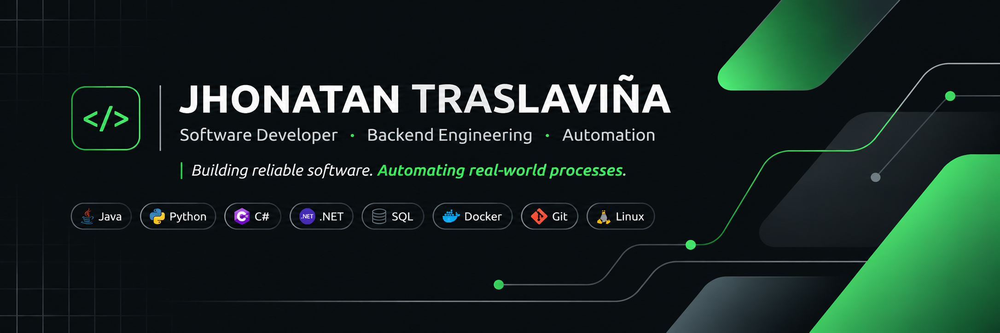

<!--
  JHONATAN TRASLAVIÑA
  GitHub Profile README
-->

  

---

## About Me · Sobre mí

**ES**

Soy desarrollador de software enfocado en el desarrollo backend, automatización de procesos e integración de sistemas empresariales.

Me interesa construir soluciones eficientes, escalables y mantenibles, combinando desarrollo de software, bases de datos e infraestructura.

Actualmente trabajo con aplicaciones empresariales, APIs, procesos automatizados y generación de reportes.

**EN**

I'm a Software Developer focused on backend engineering, process automation and enterprise system integration.

I enjoy building efficient, scalable and maintainable solutions by combining software development, databases and infrastructure.

Currently working with enterprise applications, APIs, automated processes and reporting systems.

---

<h2 align="left">Tech Stack · Tecnologías</h2>

  Technologies I use to build, automate and deploy software.
   
  Tecnologías que utilizo para desarrollar, automatizar y desplegar soluciones.

<h3>01. Backend Development</h3>

  

<h3>02. Programming & Web</h3>

  

<h3>03. Databases · Bases de datos</h3>

  
  &nbsp;&nbsp;&nbsp;
  

  <strong>SQL Server</strong>
  &nbsp;&nbsp;&nbsp;
  <strong>MySQL</strong>
  &nbsp;&nbsp;&nbsp;
  <strong>IBM Db2</strong>

<h3>04. Infrastructure & DevOps</h3>

  

<h3>05. Development Tools · Herramientas</h3>

  
  &nbsp;
  

  Visual Studio Code · Spring Boot · Git · Maven · Antigravity

---

## Featured Projects · Proyectos destacados

### 01. ZInventory
Inventory management system for Dotaciones Zambrano, featuring AI-assisted functionality.

Sistema de gestión de inventario para Dotaciones Zambrano con funcionalidades de asistencia mediante inteligencia artificial.

**Java 17 · Spring Boot · Backend**

### 02. AutomaticFactus
Web application for quotation generation and electronic invoicing automation.

Aplicación web para generación de cotizaciones y automatización de facturación electrónica.

**Java 17 · Web Development · Automation**

### 03. Token Service
Microservice for generating, validating and renewing JWT tokens.

Microservicio para generación, validación y renovación de tokens JWT.

**Backend · JWT · Security**

### 04. Encryption Service
Web service for secure text encryption and decryption using symmetric cryptography.

Servicio web para cifrado y descifrado seguro de texto mediante criptografía simétrica.

**Cryptography · Backend**

### 05. Homelab Infrastructure
Personal infrastructure for deploying and exposing applications using Docker, Nginx, Debian and Cloudflare Tunnels.

Infraestructura personal para desplegar y publicar aplicaciones utilizando Docker, Nginx, Debian y Cloudflare Tunnels.

**Linux · Docker · DevOps**

---

## What I Do · En qué trabajo

- Backend development and REST API integration.
- Enterprise database management and SQL optimization.
- Business process automation using Python and Java.
- Automated reporting and data processing.
- Application deployment and infrastructure management.

- Desarrollo backend e integración de APIs REST.
- Administración de bases de datos empresariales y optimización SQL.
- Automatización de procesos empresariales con Python y Java.
- Generación automatizada de reportes y procesamiento de datos.
- Despliegue de aplicaciones y administración de infraestructura.

---

## GitHub Activity · Actividad

*Building software, learning and improving every day.*

*Desarrollando, aprendiendo y mejorando cada día.*

